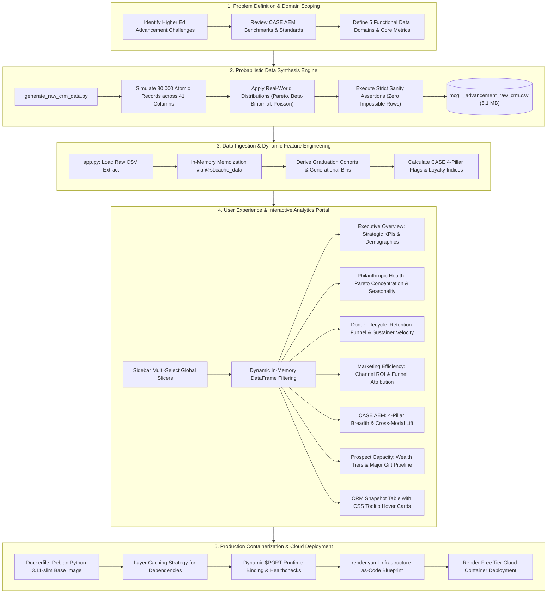

# McDill University Advancement Intelligence & CASE Analytics Portal

**Live Application Demo:** [https://university-advancement.onrender.com/](https://university-advancement.onrender.com/)

> [!NOTE]
> **Render Free Tier Notice:** Web services on Render Free Tier automatically enter sleep mode after fifteen minutes of inactivity. If the service is currently inactive, please allow approximately 30 to 50 seconds for the Docker container to spin up, then refresh the page if needed.

---

## 1. Project Title, Overview & Live Demo

**McDill University Advancement Intelligence** is an enterprise-grade institutional analytics and decision-support portal built for university leadership, advancement vice-presidents, annual giving directors, and major gift officers.

### The Core Business Problem
Higher education institutions face increasing pressure to optimize fundraising operations, justify marketing expenditures, and transition from anecdotal outreach to data-driven constituent engagement. In typical advancement divisions, data is siloed across disparate platforms:
* Core CRM databases (Salesforce, Ellucian Advance) containing demographic and academic degree history.
* Digital marketing systems (Salesforce Marketing Cloud) capturing email delivery, opens, and click-through rates.
* Web analytics engines (Google Analytics 4) recording high-intent online giving portal visits.
* Event and community platforms (Eventbrite, AlumnForce) tracking reunion attendance and alumni network logins.
* Financial ledgers recording multi-year gift transactions, recurring monthly pledges, and annual giving day totals.

Without a unified intelligence layer, leadership cannot accurately measure the Cost to Raise a Dollar (CRD), evaluate alumni retention trajectories across cohorts, or benchmark engagement against recognized industry standards such as the [Council for Advancement and Support of Education (CASE) Insights on Alumni Engagement](https://www.case.org/resources/case-insights-alumni-engagement).

### How This Platform Solves It
This portal bridges the gap between raw atomic database extracts and executive decision-making. Ingesting an enterprise dataset of 30,000 constituent records across 41 raw database fields, it executes real-time feature engineering, lifecycle segmentation, and statistical attribution. The application provides an interactive, dark-mode analytics suite that helps institutional advancement teams:
1. Track multi-year revenue velocity ($ CAD) and monitor progress toward campaign milestones.
2. Quantify marketing return on investment across digital, direct mail, and phonathon channels.
3. Diagnose donor attrition patterns (LYBUNT/SYBUNT) and measure lapsed donor reactivation rates.
4. Operationalize the 4-pillar CASE AEM framework across Philanthropic, Experiential, Volunteer, and Communication touchpoints.
5. Identify high-capacity alumni prospects in Top Wealth Screening Tiers ($100k+ capacity) for major gift cultivation.

---

## 2. Project Architecture & Development Flow

The following end-to-end architecture diagram outlines how this project was designed, developed, and deployed from initial problem scoping to production cloud hosting:



### Development Methodology Stages
1. **Problem Scoping & Domain Alignment:** Advancement operational requirements were synthesized with Council for Advancement and Support of Education guidelines to target the metrics university vice-presidents and directors track.
2. **Data Synthesis Engine (`generate_raw_crm_data.py`):** Rather than generating flat random numbers, the generator uses coupled probabilistic distributions (Pareto gift curves, Beta-Binomial marketing funnels, Negative Binomial event attendance). Rigorous sanity assertion suites guarantee zero logical contradictions.
3. **Data Preprocessing & In-Memory Enrichment (`app.py`):** High-speed ingestion leverages `@st.cache_data` to load the 30,000 constituent rows into RAM once. Derived features (Class Year cohorts, generational tags, CASE 4-pillar binary indicators) are engineered on the fly.
4. **Executive User Experience & Visualization:** Built using Streamlit and Plotly Express with a custom Executive Midnight dark theme (`#0F172A`). Each analytical module follows a standardized 2x2 grid layout with dedicated tooltips and interactive hover cards.
5. **Production Dockerization & Cloud Hosting:** Packaged with a lightweight Debian Linux base, layer-cached requirements, curl healthchecks, and dynamic port binding for reliable zero-cost hosting on Render.

---

## 3. Tech Stack & Architecture Summary

The repository is built using an enterprise Python analytics stack optimized for fast execution, interactive data visualization, and cloud containerization.

| Layer | Technologies & Libraries | Role & Implementation Details |
| :--- | :--- | :--- |
| **Data Engineering & Synthesis** | Python 3.11, NumPy, Pandas | Deterministic generation of 30,000 constituent records with 41 raw database attributes, Pareto gift distributions, and automated data integrity assertion suites. |
| **Analytics & UI Engine** | Streamlit (>=1.35.0) | High-contrast Executive Midnight interface, multi-select global slicers, in-memory caching via `@st.cache_data`, and custom responsive CSS component containers. |
| **Data Visualization** | Plotly Express, Plotly Graph Objects (>=5.18.0) | 6-chart analytical grids per module, 7 comprehensive demographic and column distribution suites on landing page, interactive tooltips, multi-year trend trajectories, and Pareto concentration charts. |
| **Containerization & Cloud Ops** | Docker, Render PaaS, Linux / Debian Slim | Production Docker containerization with layer caching, curl healthchecks, dynamic `$PORT` binding, and Render Blueprint infrastructure-as-code automation. |

---

## 4. Repository File Structure & Component Guide

```text
University_Advancement/
├── .streamlit/
│   └── config.toml                  # Streamlit server flags & Executive Midnight theme palette
├── Dockerfile                       # Multi-stage production container configuration
├── .dockerignore                    # Excluded files for streamlined Docker build context
├── render.yaml                      # Render Blueprint infrastructure-as-code deployment spec
├── requirements.txt                 # Pinned Python package dependencies
├── generate_raw_crm_data.py         # 30,000 constituent raw CRM data synthesis engine
├── mcgill_advancement_raw_crm.csv   # Synthesized raw constituent database extract (41 columns)
├── app.py                           # Main Streamlit dashboard application (6 strategic modules)
└── README.md                        # Enterprise project documentation and architecture guide
```

### Component Breakdown
* **`app.py`**: The central application script. Contains the executive dark theme CSS, data preprocessing routines, global filtering engine, KPI calculation logic, and six specialized analytical views.
* **`generate_raw_crm_data.py`**: The data synthesis script. Simulates realistic, non-random alumni constituent profiles using statistical distributions, behavioral relationship equations, and integrity assertion checks.
* **`mcgill_advancement_raw_crm.csv`**: The 41-column, 30,000-row constituent dataset produced by the simulation script. Contains atomic CRM records without pre-aggregated summaries.
* **`Dockerfile`**: Defines the Debian-based container image. Uses Python 3.11-slim, implements Docker layer caching for dependencies, installs healthcheck utilities, and dynamically binds to the host port.
* **`render.yaml`**: Infrastructure-as-code specification for deploying the Docker container directly to Render Free Tier web services.
* **`.streamlit/config.toml`**: Configures the base dark mode, McDill Crimson primary accent (`#ED1B2F`), slate card backgrounds (`#1E293B`), and headless server settings.
* **`requirements.txt`**: Specifies exact library versions required for repeatable environments across local machines and cloud containers.

---

## 5. Dataset Schema & Complete Column Data Dictionary

The underlying dataset (`mcgill_advancement_raw_crm.csv`) models a comprehensive constituent extract at the close of Fiscal Year 2026 (May 1, 2025 to April 30, 2026). It contains **30,000 constituent records** and **41 raw database columns** organized across five functional advancement domains:

### Domain 1: Constituent Demographics & Education (10 Columns)
| Column Name | Data Type | Description |
| :--- | :--- | :--- |
| `Constituent_ID` | String | Unique 8-digit identifier assigned to each alumni or donor record (e.g., MCG-1000001). |
| `Class_Year` | Integer | Undergraduate or primary completion graduation year (cohorts between 1965 and 2025). |
| `Birth_Year` | Integer | Calendar year of constituent birth, logically aligned with degree duration. |
| `Gender` | String | Self-reported gender identity of constituent (Female, Male, Non-Binary / Other). |
| `Primary_Degree_Type` | String | Academic degree attained (Undergraduate 68%, Masters 22%, PhD 5%, MD/JD 5%). |
| `Primary_Faculty` | String | Primary academic division affiliation (Arts, Science, Management, Engineering, Medicine, etc.). |
| `Country_of_Residence` | String | Primary mailing address country (Canada 67%, US 18%, UK, France, Hong Kong, Other). |
| `Province_State` | String | Canadian province or US state code; populated only for North American addresses. |
| `Preferred_Language` | String | Preferred communication language (English 78%, French 22%). |
| `Wealth_Screening_Rating` | String | Third-party estimated net worth tier (Tier 1 $100k+, Tier 2 $25k-$99k, down to Unrated). |

### Domain 2: Digital & Marketing Cloud Logs (8 Columns)
| Column Name | Data Type | Description |
| :--- | :--- | :--- |
| `Has_Valid_Email` | Integer (0/1) | Flag indicating a deliverable email address is on file (92% valid). |
| `Email_Opt_Out_Flag` | Integer (0/1) | Flag indicating constituent unsubscribed from appeals; automatically 1 if email is invalid. |
| `Emails_Delivered_FY26` | Integer | Count of advancement marketing emails delivered in FY26 (0 if opted out, else 8 to 32). |
| `Emails_Opened_FY26` | Integer | Delivered emails opened in FY26 (Beta-Binomial draw calibrated to ~28% average open rate). |
| `Emails_Clicked_FY26` | Integer | Links clicked inside advancement emails in FY26 (0% to 40% of opened emails). |
| `GA4_Giving_Page_Views_FY26` | Integer | Google Analytics 4 pageviews on the online giving portal (0 to 18, correlated with email clicks). |
| `McGill_Connect_Registered` | Integer (0/1) | Registration flag for the official McDill Connect alumni networking platform (~18% overall). |
| `McGill_Connect_Logins_FY26` | Integer | Total user logins to the alumni networking portal in FY26 (Poisson draw, 0 to 25). |

### Domain 3: Experiential Events & Volunteer Logs (7 Columns)
| Column Name | Data Type | Description |
| :--- | :--- | :--- |
| `Lifetime_Events_Attended` | Integer | Cumulative university events attended over lifetime (Negative Binomial, higher for local alumni). |
| `Events_Registered_FY26` | Integer | Total university events registered for during FY26 (~26% register for at least one). |
| `Events_Attended_FY26` | Integer | University events attended in FY26, accounting for an approximate 20% no-show drop-off. |
| `Attended_Homecoming_FY26` | Integer (0/1) | Attendance flag for Homecoming weekend; elevated for 5-year reunion milestone cohorts. |
| `Is_Active_Volunteer_FY26` | Integer (0/1) | Active alumni volunteer, mentor, or board member in FY26 (~5.5% participation rate). |
| `Volunteer_Hours_Logged_FY26` | Float | Total logged volunteer hours in FY26 (strictly 0 for non-volunteers, 2.0 to 65.0 for active). |
| `Alumni_Survey_Completed_FY26`| Integer (0/1) | Completion flag for the biennial alumni sentiment survey (~11% completion rate). |

### Domain 4: Solicitation & Campaign Outreach (4 Columns)
| Column Name | Data Type | Description |
| :--- | :--- | :--- |
| `Primary_Solicitation_Channel_FY26` | String | Assigned channel (Digital, Direct Mail, Phonathon, Crowdfunding McDill24, or No Solicitation). |
| `Direct_Mail_Pieces_Sent_FY26` | Integer | Physical appeal letters mailed to constituent (0 to 4, higher for older alumni). |
| `Phonathon_Calls_Completed_FY26` | Integer | Student phonathon call connections completed in FY26 (0 to 3). |
| `Marketing_Outreach_Cost_FY26` | Float | Exact marketing cost ($0.08/email + $3.75/mail + $6.50/call + $0.50 if GA4 visits > 0). |

### Domain 5: Multi-Year Philanthropic & Gift History (12 Columns)
| Column Name | Data Type | Description |
| :--- | :--- | :--- |
| `Lifetime_Gift_Count_Prior_To_FY24` | Integer | Total count of donations recorded prior to fiscal year 2024 (~38% prior donors). |
| `Lifetime_Giving_Amount_Prior_To_FY24` | Float | Total dollars ($ CAD) donated prior to fiscal year 2024 (0.0 if prior count is 0). |
| `Gift_Count_FY24` | Integer | Number of distinct donations recorded in FY2024 (~13% donor rate). |
| `Giving_Amount_FY24` | Float | Total dollars ($ CAD) donated in FY2024 (Pareto heavy-tailed distribution). |
| `Gift_Count_FY25` | Integer | Number of distinct donations recorded in FY2025 (~14% donor rate, 62% retention from FY24). |
| `Giving_Amount_FY25` | Float | Total dollars ($ CAD) donated in FY2025. |
| `Gift_Count_FY26` | Integer | Number of distinct donations recorded in FY2026 (14% to 16% donor rate). |
| `Giving_Amount_FY26` | Float | Total dollars ($ CAD) donated in FY2026. |
| `McGill24_Gift_Amount_FY26` | Float | Dollars donated specifically during the McDill24 24-hour giving day blitz in FY26. |
| `Is_Monthly_Sustainer_FY26` | Integer (0/1) | Recurring monthly donor flag (strictly 1 if Gift_Count_FY26 >= 6, else 0). |
| `Last_Gift_Date` | String / Null | Date (YYYY-MM-DD) of most recent donation; strictly null for lifetime non-donors. |
| `Last_Gift_Designation` | String / Null | Fund designation (The McDill Fund, Scholarships, Priority, Research, Athletics); null for non-donors. |

---

## 6. Dashboard Architecture & User Experience

The application is structured into a unified executive interface with left-sidebar global slicers and six distinct module views:

### Global Slicers & Filtering
All filters reside in the collapsible left sidebar and default to "All" options:
* **Academic Faculty:** Multiselect supporting Arts, Science, Desautels Management, Engineering, Medicine, Education, Law, and Agricultural & Environmental Sciences.
* **Cohort Selector:** Multiselect grouping alumni into Young Alumni (<10 yrs), Mid-Career (10-25 yrs), and Senior Alumni (25+ yrs).
* **Geographic Region:** Multiselect filtering by Quebec, Rest of Canada, United States, and International regions.
* **Wealth Capacity Tier:** Multiselect isolating Tier 1 ($100k+), Tier 2 ($25k-$99k), Tier 3 ($5k-$24k), Tier 4 ($1k-$4.9k), Tier 5 (Under $1k), and Unrated records.

### Summary of the 6 Dashboard Modules

#### View 1: Executive Overview (Landing Dashboard)
* **Purpose:** Single-pane institutional briefing for the President, Provost, and Vice-President of Advancement.
* **Primary KPI Cards:** Total Revenue ($ CAD), Active Donors, Alumni Participation Rate (%), Donor Retention Rate (%), Average Gift Yield ($ CAD), Marketing ROI Multiple.
* **Secondary Aligned Cards:** McDill24 Giving Day Revenue ($ CAD), Monthly Sustainers (Count and Share), Campaign Goal Pace ($4M Goal).
* **Comprehensive Column Distribution Suites (7 Suites):**
  1. *Development Revenue Velocity (FY24 to FY26):* Multi-year area spline tracking fundraising trajectory.
  2. *Gift Designation Allocation Share:* Donut chart breakdown across university fund priorities.
  3. *Graduation Class Year Timeline (1965 to 2025):* Area plot of addressable alumni density across 60 cohorts.
  4. *Generational Age Distribution:* Bar chart of birth cohorts (Silent, Boomers, Gen X, Millennials, Gen Z).
  5. *Constituent Gender Identity Breakdown:* Donut chart of female, male, and non-binary/other representation.
  6. *Global Footprint:* Horizontal ranking of alumni across top international countries of residence.
  7. *Academic Faculty Distribution:* Constituent counts across all eight faculties.
  8. *CASE 4-Pillar Multi-Modal Engagement Depth:* Donut chart showing constituent spread from 0 to 4 engagement modes.
  9. *Primary Degree Type Distribution:* Proportions of Undergraduate, Masters, PhD, and Professional (MD/JD) degrees.
  10. *Constituent Wealth Screening Capacity Distribution:* Headcount across Tier 1 ($100k+) through Tier 5 and Unrated.
  11. *Preferred Language & Deliverable Email Status:* English vs. French constituents cross-tabulated with valid email deliverability.
  12. *Primary Solicitation Channel Allocation:* Breakdown of FY26 outreach assignments across marketing channels.
  13. *FY26 Giving Frequency Distribution:* Non-donors, single-gift donors, repeat donors, and monthly sustainers (6+ gifts).
  14. *North American Regional Footprint:* Top Canadian provinces and US states of residence.
* **Dataset Snapshot:** Interactive HTML preview of the underlying 41-column CRM extract with custom hover tooltips detailing every column definition.

#### View 2: Philanthropic Health & Revenue
* **Purpose:** Financial auditing of fundraising yield, giving tier concentration, and revenue velocity.
* **KPIs:** FY26 Total Commitments, Average Gift Yield, McDill24 Campaign Contribution.
* **Visualizations (6-Chart Analytical Suite):**
  1. *Multi-Year Commitments Trajectory (FY24 to FY26):* Assesses year-over-year fundraising growth.
  2. *Giving Amount Tier Concentration (Pareto Dispersion):* Breaks down dollars by gift bracket (<$100 to $10k+).
  3. *Monthly Giving Seasonality Trend:* Tracks calendar peaks around year-end tax deadlines and Giving Day.
  4. *Average Gift Yield by Academic Faculty:* Ranks academic divisions by average donation size.
  5. *McDill24 Giving Day Yield by Academic Faculty:* Measures 24-hour crowdfunding commitments mobilized by faculty.
  6. *Philanthropic Commitments by Degree Level:* Evaluates total funding and average gift yield across degree levels.

#### View 3: Donor Lifecycle & Retention Funnel
* **Purpose:** Evaluates constituent migration dynamics across consecutive renewal, attrition risk, and reactivation.
* **KPIs:** Consecutive Retention Rate (FY25 to FY26), Lapsed Reactivation Rate, First-Time Donor Acquisition Rate, Monthly Sustainer Penetration.
* **Visualizations (6-Chart Analytical Suite):**
  1. *Donor Migration Flow (FY25 to FY26):* Sankey diagram visualizing flow into retained, LYBUNT, reactivated, and acquired states.
  2. *Consecutive Retention by Graduation Cohort:* Contrasts renewal rates across Young, Mid-Career, and Senior alumni.
  3. *Lapsed Reactivation Rate by Solicitation Channel:* Evaluates recovery effectiveness across marketing channels.
  4. *Prior Giving History vs. FY26 Renewal Rate:* Demonstrates the power of historical giving habituation on renewal.
  5. *First-Time Donor Acquisition Rate by Faculty:* Identifies faculties with the most effective new donor onboarding pipelines.
  6. *Monthly Sustainer Adoption Share by Generation:* Evaluates automated recurring giving penetration across age cohorts.

#### View 4: Marketing Efficiency & Channels
* **Purpose:** Analyzes the economic return of solicitation channels and tracks digital giving funnel conversion.
* **KPIs:** Cost per Dollar Raised (CPDR), Marketing ROI Multiple, Email Open Rate (%), GA4 Online Giving Portal Conversion Rate (%).
* **Visualizations (6-Chart Analytical Suite):**
  1. *Channel Conversion Rate (%):* Measures donor conversion efficiency across channels.
  2. *Digital Giving Funnel:* Five-stage progression tracking drop-off from delivered email to completed donation.
  3. *Marketing ROI Multiplier by Solicitation Channel:* Ranks solicitation channels by return on marketing investment.
  4. *Direct Mail & Phonathon Appeal Volume vs. Donors:* Contrasts physical outreach volume with resulting donor counts.
  5. *Cost to Raise a Dollar (CRD) by Solicitation Channel:* Evaluates fundraising expenditure per dollar against AFP $0.15 standard.
  6. *Digital Email Engagement Rates by Academic Faculty:* Compares email open and click-through rates across faculties.

#### View 5: CASE 4-Pillar Engagement (AEM)
* **Purpose:** Operationalizes the Council for Advancement and Support of Education framework across all four recognized dimensions. For detailed reference on the underlying framework, visit the official [CASE Insights on Alumni Engagement](https://www.case.org/resources/case-insights-alumni-engagement) portal.
* **The 4 CASE Pillars:**
  1. *Philanthropic:* Monetary gifts, annual pledges, and recurring monthly donations.
  2. *Experiential:* In-person and virtual event attendance, class reunions, and webinars.
  3. *Volunteer:* Alumni boards, student mentoring, advisory panels, and committee leadership.
  4. *Communication:* Opening digital university appeals, reading newsletters, and McDill Connect logins.
* **KPIs:** Event Attendance Rate (Experiential), Ticket Show Rate (Realized Attendance), 2+ CASE Modes Multi-Modal Share, Active Volunteers Count.
* **Visualizations (6-Chart Analytical Suite):**
  1. *CASE Engagement Modes vs. Giving Rate (%):* Demonstrates how multi-modal engagement exponentially lifts giving rates.
  2. *CASE 4-Pillar Constituent Participation Breakdown:* Compares penetration across Communication, Experiential, Philanthropic, and Volunteer modes.
  3. *Experiential Pillar: Registration vs. Show Rate:* Evaluates event attendance conversion across graduation cohorts.
  4. *Volunteer Leadership Philanthropic Impact:* Compares giving rates of active volunteers against non-volunteers.
  5. *Volunteer Pillar: Logged Hours Commitment Brackets:* Analyzes volunteer counts and giving rates across hours logged.
  6. *Communication Pillar: Digital Portal Logins by Cohort:* Tracks McDill Connect portal adoption and login frequency.

#### View 6: Prospect Capacity & Faculty Intelligence
* **Purpose:** Equips major gift officers and faculty development directors with wealth screening insights and prioritized prospect pipelines.
* **KPIs:** Top Tier Giving ($100k+ Tier 1 & Tier 2 Totals), Tier 1 ($100k+) Conversion Rate, Tier 2 ($25k-$99k) Conversion Rate.
* **Visualizations (6 Analytical Components):**
  1. *Faculty Commitments ($ CAD):* Ranks academic divisions by total philanthropic commitments secured.
  2. *Wealth Capacity Tier Conversion Rates (%):* Evaluates giving rates across wealth screening brackets.
  3. *Wealth Screening Matrix:* Cross-tabulates alumni counts, donor totals, participation rates, and dollars raised per tier.
  4. *Major Gift Pipeline ($25k+ Capacity) by Faculty:* Identifies major gift opportunity pools across academic divisions.
  5. *Capacity Tier Composition by Generational Cohort:* Stacked distribution of wealth tiers across age generations.
  6. *Average Realized Gift Size by Capacity Tier:* Compares mean donation amounts realized from active donors within each tier.

---

## 7. Complete KPI Framework & Metric Directory

The following directory outlines every Key Performance Indicator computed in the application, organized by its specific **Dashboard Module**:

| Dashboard Module | Metric Name | Business Definition | Underlying Calculation Formula | Benchmark / Target |
| :--- | :--- | :--- | :--- | :--- |
| **Executive Overview** | Total Revenue | Cumulative philanthropic gifts, pledges, and outright commitments secured in FY26. | `Sum(Giving_Amount_FY26)` | Annual Target: $3.0M to $6.5M |
| **Executive Overview** | Active Donors | Total unique addressable constituents who completed at least one monetary donation in FY26. | `Count(Constituent_ID where Gift_Count_FY26 > 0)` | Annual Target: 4,000 to 4,800 |
| **Executive Overview** | Participation Rate | Proportion of the addressable alumni universe contributing financially in FY26. | `(Active Donors / Total Filtered Count) * 100` | U15 Peer Median: 8.0% to 12.0% |
| **Executive Overview** | Retention Rate | Proportion of prior-year (FY25) donors who renewed their financial support in FY26. | `(Donors in FY25 & FY26 / Donors in FY25) * 100` | CASE Higher Ed Average: 60% to 65% |
| **Executive Overview** | Average Gift Yield | Average revenue yield per active contributing donor. | `Total FY26 Revenue / Active Donors FY26` | U15 Peer Median: $725 |
| **Executive Overview** | Marketing ROI | Return multiple measuring revenue generated per dollar of marketing outreach spent. | `Total FY26 Revenue / Total Outreach Cost` | Best-in-Class Benchmark: > 6.7x |
| **Executive Overview** | McDill24 Campaign | Philanthropic commitments mobilized during the 24-hour giving day blitz. | `Sum(McGill24_Gift_Amount_FY26)` | Target: > 18.0% of Annual Revenue |
| **Executive Overview** | Monthly Sustainers | Count and proportion of active donors contributing via automated monthly gifts. | `(Donors with Gift_Count_FY26 >= 6 / Active Donors) * 100` | Industry Standard: 20% to 25% |
| **Executive Overview** | Campaign Goal Pace | Cumulative FY26 philanthropic revenue pacing against the strategic $100M campaign target. | `(Total FY26 Revenue / $100,000,000) * 100` | Multi-Year Campaign Trajectory |
| **Philanthropic Health** | FY26 Total Commitments | Gross philanthropic commitments received across all funds, chairs, and faculties. | `Sum(Giving_Amount_FY26)` | Operational Plan Target: $3.25M |
| **Philanthropic Health** | Average Gift Yield | Average philanthropic revenue yield per active donor across the filtered universe. | `Total Revenue FY26 / Active Donors FY26` | U15 Peer Median: $725 |
| **Philanthropic Health** | McDill24 Campaign | Commitments secured during the 24-hour university-wide crowdfunding blitz. | `Sum(McGill24_Gift_Amount_FY26)` | Target: > 18.0% of Annual Revenue |
| **Donor Lifecycle** | Consecutive Retention | Percentage of FY25 active donors who renewed their financial contribution in FY26. | `(Donated FY25 & Donated FY26 / Donated FY25) * 100` | CASE Benchmark: 60.0% to 65.0% |
| **Donor Lifecycle** | Lapsed Reactivation | Percentage of prior donors who skipped FY25 but were reactivated in FY26. | `(Donated FY26 & Gave Prior & ~Donated FY25) / Lapsed Pool * 100` | CASE Benchmark: 10.0% to 12.0% |
| **Donor Lifecycle** | New Acquisition | Conversion rate of lifetime non-donors making their first university gift in FY26. | `(First-Time Donors FY26 / Addressable Never-Givers) * 100` | Industry Benchmark: 3.0% to 6.0% |
| **Donor Lifecycle** | Monthly Sustainers | Proportion of active donors enrolled in automated recurring monthly giving. | `(Donors with Gift_Count_FY26 >= 6 / Active Donors) * 100` | Industry Standard: 20.0% to 25.0% |
| **Marketing Efficiency**| Cost per $ Raised (CPDR) | Direct marketing expenditure incurred for each single dollar of revenue raised. | `Total Outreach Cost / Total Revenue FY26` | Association of Fundraising Professionals: < $0.15 |
| **Marketing Efficiency**| Marketing ROI | Efficiency ratio measuring revenue return generated per marketing dollar invested. | `Total Revenue FY26 / Total Outreach Cost` | Best-in-Class Benchmark: > 6.7x |
| **Marketing Efficiency**| Email Open Rate | Engagement rate of direct digital appeal emails delivered to alumni. | `(Total Emails Opened / Total Emails Delivered) * 100` | Higher Ed Benchmark: 25% to 30% |
| **Marketing Efficiency**| GA4 Web Conversion | Share of giving portal web visitors who successfully completed a donation. | `(Web Visitors who Donated FY26 / Total Web Visitors) * 100` | Non-Profit E-Commerce: 15% to 22% |
| **CASE 4-Pillar (AEM)** | Event Attendance Rate | Proportion of alumni participating in at least one university event in FY26. | `(Count with Events_Attended_FY26 > 0 / Total Alumni) * 100` | CASE Experiential Target: 10% to 15% |
| **CASE 4-Pillar (AEM)** | Ticket Show Rate | Percentage of event registrants who physically or virtually attended programming. | `(Total Events Attended / Total Events Registered) * 100` | Industry Attendance Average: 55% to 65% |
| **CASE 4-Pillar (AEM)** | 2+ CASE Modes | Share of alumni participating across two or more CASE engagement pillars. | `(Count with CASE_Pillar_Count >= 2 / Total Universe) * 100` | Multi-Modal Lift: 9x higher giving rate |
| **CASE 4-Pillar (AEM)** | Active Volunteers | Proportion of alumni serving as mentors, committee members, or ambassadors. | `(Count with Is_Active_Volunteer_FY26 == 1 / Total Universe) * 100` | CASE Volunteer Benchmark: 4% to 7% |
| **Prospect Capacity** | Top Tier Giving | Philanthropic commitments secured from major and principal gift prospects (Tiers 1 & 2). | `Sum(Giving_Amount_FY26 for Wealth Tiers 1 and 2)` | Major gift tiers yield > 65% of funds |
| **Prospect Capacity** | Tier 1 ($100k+) Conv | Philanthropic conversion rate among highest-capacity rated alumni prospects. | `(Tier 1 Donors / Total Tier 1 Rated Prospects) * 100` | Principal Gift Target: > 60% participation |
| **Prospect Capacity** | Tier 2 ($25k-$99k) Conv| Philanthropic conversion rate among leadership annual and major gift prospects. | `(Tier 2 Donors / Total Tier 2 Rated Prospects) * 100` | Major Gift Target: > 45% participation |

---

## 8. Local Setup & Docker Usage Instructions

### Prerequisites
* Python 3.11 or higher
* Git
* Docker Desktop (optional, for containerized execution)

### Option A: Local Python Virtual Environment

1. **Clone the Repository:**
   ```bash
   git clone https://github.com/KalashDave/University_Advancement.git
   cd University_Advancement
   ```

2. **Create and Activate a Virtual Environment:**
   * On macOS / Linux:
     ```bash
     python3 -m venv venv
     source venv/bin/activate
     ```
   * On Windows (PowerShell):
     ```powershell
     python -m venv venv
     .\venv\Scripts\Activate.ps1
     ```

3. **Install Dependencies:**
   ```bash
   pip install --upgrade pip
   pip install -r requirements.txt
   ```

4. **Regenerate the CRM Dataset (Optional):**
   ```bash
   python generate_raw_crm_data.py
   ```
   *Running this script executes 30,000 constituent simulations, validates all integrity assertions, and refreshes `mcgill_advancement_raw_crm.csv`.*

5. **Launch the Streamlit Application:**
   ```bash
   streamlit run app.py
   ```
   *Open your browser and navigate to `http://localhost:8501` to view the portal.*

---

### Option B: Docker Container Execution

1. **Build the Docker Image:**
   ```bash
   docker build -t university-advancement:latest .
   ```

2. **Run the Container Locally:**
   ```bash
   docker run -d --name mcdill_dashboard -p 8501:8501 university-advancement:latest
   ```

3. **Access the Containerized Portal:**
   * Open `http://localhost:8501` in your browser.
   * To inspect container logs:
     ```bash
     docker logs -f mcdill_dashboard
     ```
   * To stop the container:
     ```bash
     docker stop mcdill_dashboard && docker rm mcdill_dashboard
     ```

---

## 9. Author & Contact

**Kalash Dave**  
* GitHub: [https://github.com/KalashDave](https://github.com/KalashDave)  
* Project Repository: [https://github.com/KalashDave/University_Advancement](https://github.com/KalashDave/University_Advancement)
